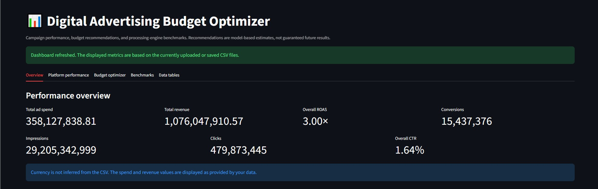
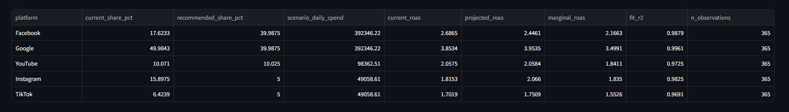

# Digital Advertising Budget Optimizer

A big data analytics project that simulates digital marketing campaigns at scale, benchmarks three data-processing approaches, calculates marketing KPIs, and recommends how to allocate an advertising budget across platforms.

The project processes datasets ranging from **10K to 10M records** and compares Pandas, a simulated MapReduce implementation, and PySpark.

## Table of Contents

- [Features](#features)
- [Project Structure](#project-structure)
- [Tech Stack](#tech-stack)
- [Setup](#setup)
- [Running the Project](#running-the-project)
- [Architecture](#architecture)
- [Dashboard UI](#dashboard-ui)
- [Budget Optimization](#budget-optimization)
- [Benchmark Results](#benchmark-results)
- [Platform Performance](#platform-performance)
- [Limitations](#limitations)

## Features

- **Scalable synthetic data generation:** Generate campaign data from 10K to 10M records in chunks.
- **Marketing KPI analytics:** Calculate CTR, CPC, CPA, conversion rate, ROAS, and CPM.
- **Processing-engine benchmarks:** Compare Pandas, simulated MapReduce, and PySpark.
- **Memory and runtime measurement:** Record execution time and process memory usage.
- **Budget optimization:** Fit diminishing-returns response curves and allocate budgets using marginal revenue.
- **Configurable allocation constraints:** Set minimum and maximum budget shares for each platform.
- **Interactive dashboard:** Explore KPI results, budget recommendations, and benchmark outputs.

## Project Structure

```text
Digital-Advertising-Budget-Optimizer/
├── app.py
├── main.py
├── data_generator.py
├── metrics_calculator.py
├── benchmark_analysis.py
├── budget_optimizer.py
├── requirements.txt
├── data/
│   └── Generated campaign datasets
├── results/
│   ├── kpis_by_platform.csv
│   ├── benchmark_results.csv
│   └── budget_recommendation.csv
└── assets/
    ├── budget-optimizer.png
    └── UI-of-ad-budget-optimizer.png
```

*The structure above shows the expected locations for the screenshots. Keep the actual filenames and extensions consistent with your repository.*

## Tech Stack

- **Python** — core implementation
- **Pandas** — tabular processing and aggregation
- **NumPy** — numerical operations and synthetic data generation
- **PySpark** — distributed-processing framework in local mode
- **Matplotlib / Plotly** — visualizations, where used
- **Streamlit** — interactive dashboard
- **pytest** — automated testing

## Setup

Requirements:

- Python 3.10 or newer
- Java 17 or newer for PySpark
- Additional dependencies listed in `requirements.txt`

Install dependencies:

```bash
pip install -r requirements.txt
```

If PySpark or Java is unavailable, check the benchmark implementation's skip behavior and installation instructions.

## Running the Project

Run the standard pipeline:

```bash
python main.py
```

Include the 10M-record scale:

```bash
python main.py --full
```

Run KPI calculations and budget optimization without benchmarking:

```bash
python main.py --skip-benchmark
```

Select processing engines:

```bash
python main.py --engines pandas mapreduce
```

Customize budget constraints:

```bash
python main.py --budget 50000 --min-share 0.10 --max-share 0.35
```

Run individual modules:

```bash
python data_generator.py --records 1000000
python benchmark_analysis.py --scales 100000
```

Launch the dashboard:

```bash
streamlit run app.py
```

The dashboard reads the generated result CSVs or files uploaded through its interface. Refreshing the dashboard updates the displayed data; it does not necessarily rerun the underlying analytics pipeline.

Generated datasets are stored in `data/`, while analytical results are written to `results/`.

## Architecture

```text
              data_generator.py
                      |
                      v
             Campaign CSV datasets
                      |
          +-----------+-----------+
          |           |           |
          v           v           v
     KPI Analysis  Benchmark   Budget Optimizer
                   Analysis         |
          |           |             |
          v           v             v
     Platform KPIs  Runtime &   Response Curves
                    Memory          |
          |           |             |
          +-----------+-------------+
                      |
                      v
                    main.py
                      |
                      v
             Results in CSV files
                      |
                      v
                 Streamlit UI
```

### Data Generation

The generator simulates campaign performance across Facebook, Google, YouTube, Instagram, and TikTok. Each platform has its own cost, click-through rate, conversion rate, average order value, and saturation exponent.

Daily demand incorporates weekday patterns, seasonal effects, including a fourth-quarter peak, and random variation. Conversion efficiency decreases as demand increases to simulate diminishing returns.

Counts are generated so that:

$$
\text{Conversions} \leq \text{Clicks} \leq \text{Impressions}
$$

A fixed random seed makes generation reproducible for the same configuration.

### KPI Calculation

KPIs are calculated from aggregated totals rather than by averaging row-level ratios.

| KPI | Formula |
|---|---|
| CTR | $\dfrac{\text{Clicks}}{\text{Impressions}} \times 100$ |
| CPC | $\dfrac{\text{Spend}}{\text{Clicks}}$ |
| CPA | $\dfrac{\text{Spend}}{\text{Conversions}}$ |
| Conversion Rate | $\dfrac{\text{Conversions}}{\text{Clicks}} \times 100$ |
| ROAS | $\dfrac{\text{Revenue}}{\text{Spend}}$ |
| CPM | $\dfrac{\text{Spend}}{\text{Impressions}} \times 1000$ |

Undefined ratios use `NaN` when their denominators are zero.

### Benchmark Methodology

The benchmark aggregates campaign metrics by platform and campaign.

- **Pandas:** Reads the CSV and aggregates with `groupby`.
- **Simulated MapReduce:** Splits the file into line-aligned byte ranges, performs local mapping and combining in worker processes, partitions keys, and reduces the results.
- **PySpark:** Uses local mode, an explicit schema, and `groupBy().agg()`.

The benchmark records execution time and sampled process memory. PySpark session startup is reported separately from processing time. Group counts and total spend are checked for consistency across engines.

## Dashboard UI

The Streamlit dashboard provides an interface for exploring platform performance, budget recommendations, benchmark timings, and the generated result tables.



The dashboard is designed to make analytical results easier to inspect without manually opening every CSV file.

## Budget Optimization

For each platform, historical campaign data is aggregated into daily spend and revenue. A power-law response curve is fitted using log-log regression:

$$
\text{Revenue} = a \cdot \text{Spend}^{b}
$$

Here, $b$ represents spend elasticity. Lower elasticity indicates that returns diminish more quickly as spend increases.

The optimizer calibrates the curve against historical daily revenue and distributes the available budget in small increments. Each increment goes to the platform with the highest estimated marginal revenue, subject to the configured allocation constraints.

This approach is intended for concave response curves and the assumptions used by the simulator; it does not guarantee optimal performance in real advertising campaigns.

### Example Budget Recommendation

The following image shows the optimizer's recommended allocation across platforms.



Example output from the reported simulation:

| Platform | Current Share | Recommended Share | Marginal ROAS | Elasticity |
|---|---:|---:|---:|---:|
| Facebook | 25.0% | 40.0% | 1.85× | 0.75 |
| Google | 30.6% | 40.0% | 2.10× | 0.60 |
| Instagram | 24.5% | 7.7% | 1.83× | 0.80 |
| YouTube | 10.1% | 7.3% | 1.83× | 0.85 |
| TikTok | 9.9% | 5.0% | 1.61× | 0.88 |

In this simulation, Google and Facebook reach the maximum allocation limit, while TikTok reaches the minimum. The allocation reflects estimated marginal returns and configured constraints, not just historical average ROAS.

The reported run estimates that projected daily revenue increases by approximately **4% at the same total spend**, with blended ROAS rising from 2.70× to 2.81×. Treat these as simulation-specific results, not guaranteed real-world outcomes.

## Benchmark Results

The following results were reported for a run on a 1 vCPU, 3 GB machine using Python 3.12, pandas 3.0, and PySpark 4.2. Runtime and memory measurements vary with hardware, software versions, and workload.

| Records | Pandas | MapReduce | PySpark | Peak Memory: Pandas / MapReduce / Spark |
|---:|---:|---:|---:|---:|
| 10K | 0.02 s | 0.40 s | 7.51 s | 73 / 145 / 512 MB |
| 100K | 0.12 s | 0.54 s | 8.88 s | 95 / 170 / 527 MB |
| 1M | 1.21 s | 1.63 s | 10.57 s | 163 / 233 / 528 MB |
| 10M | 10.74 s | 11.84 s | 28.02 s | 1,379 / 1,152 / 563 MB |

*Processing times exclude PySpark startup; startup overhead is reported separately. Confirm that the measurements above correspond to the version and run being published.*

### Key Observations

- **Pandas performs best on this test machine:** Its low startup overhead helps it outperform the other implementations at the tested scales.
- **Processing costs increase with dataset size:** Pandas memory usage rises substantially as the input grows.
- **PySpark has higher overhead on small workloads:** Its startup and execution costs outweigh the benefits of distributed processing on this single-core setup.
- **MapReduce adds process overhead:** The simulated implementation may benefit from additional CPU cores, but this benchmark does not demonstrate a speed advantage on the tested machine.
- **Memory and runtime are environment-specific:** These measurements should not be interpreted as universal rankings of the frameworks.

## Platform Performance

Example KPI results from the reported 10M-record simulation:

| Platform | CTR | CPC | CPA | Conversion Rate | ROAS |
|---|---:|---:|---:|---:|---:|
| Google | 3.01% | $0.74 | $18.73 | 3.94% | 3.89× |
| Facebook | 1.21% | $0.71 | $22.67 | 3.13% | 2.77× |
| YouTube | 0.81% | $1.12 | $35.56 | 3.15% | 2.05× |
| Instagram | 1.00% | $0.99 | $37.77 | 2.61% | 1.82× |
| TikTok | 1.45% | $0.38 | $26.97 | 1.42% | 1.69× |

Google has the highest reported average ROAS in this simulation. TikTok has the lowest CPC but also the lowest ROAS. These differences illustrate why budget decisions should consider marginal returns and constraints rather than relying on a single KPI.

## Limitations

- **Synthetic data:** Simulated campaigns do not fully represent real-world attribution, creative quality, audience overlap, or platform-specific reporting differences.
- **Simplified response curves:** The optimizer treats spend as the primary driver of revenue and does not model cross-platform interactions.
- **Limited historical coverage:** Recommendations can be unreliable when projected spend falls far outside the range represented by historical data.
- **Benchmark environment:** Results from a single-core machine may not represent performance on a multi-core workstation or cluster.
- **Memory sampling:** RSS measurements are sampled, so short runs may be imprecise; shared worker-process memory may also be counted more than once.
- **Model validation:** A good fit on synthetic data does not establish predictive accuracy on real campaigns. Real deployments should use held-out data, controlled experiments, and ongoing monitoring.

## Future Improvements

- Validate recommendations against held-out campaign data.
- Add confidence intervals and sensitivity analysis for budget allocations.
- Compare serial and parallel processing across machines with different core counts.
- Add additional benchmark correctness checks for all aggregated metrics.
- Support exporting reports and recommendations directly from the dashboard.
- Evaluate the optimizer on real, appropriately attributed campaign data before using it for business decisions.

---

**Note:** The benchmark and KPI tables contain example results from a particular reported run. Re-run the pipeline and update these figures whenever the code, data-generation settings, dependencies, or benchmark environment changes.