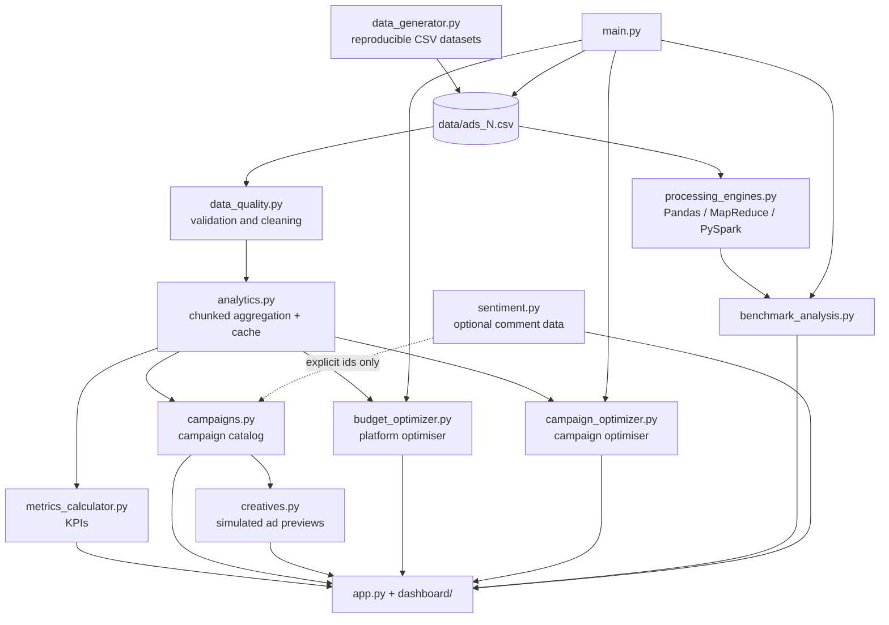
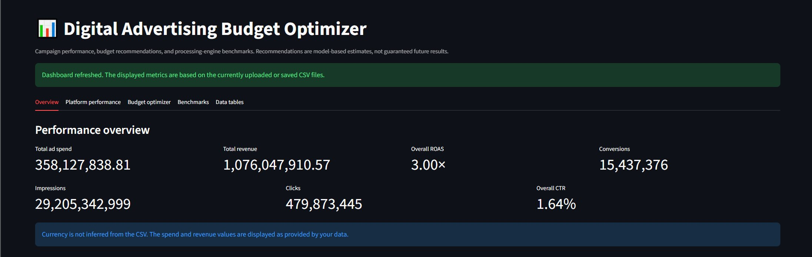
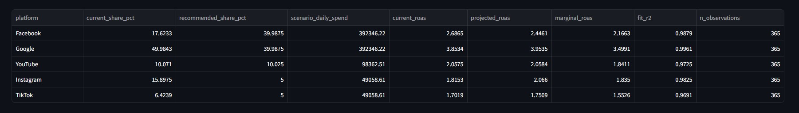

# Digital Advertising Budget Optimizer

A big data analytics project that simulates digital advertising campaigns at scale, benchmarks three data-processing approaches, visualises campaigns and their advertisements, and recommends how to redistribute an advertising budget across platforms and individual campaigns.

> **All advertising data in this project is simulated.** Campaigns, budgets, audiences, results and ad creatives are generated for demonstration. Nothing here describes real campaigns, and no advertisement was ever published.

## Table of Contents

1. [Project Overview](#1-project-overview)
2. [Problem Statement](#2-problem-statement)
3. [Objectives](#3-objectives)
4. [Main Features](#4-main-features)
5. [Technology Stack](#5-technology-stack)
6. [Architecture](#6-architecture)
7. [Project Structure](#7-project-structure)
8. [Installation](#8-installation)
9. [Environment Setup](#9-environment-setup)
10. [Execution Instructions](#10-execution-instructions)
11. [Dataset Generation](#11-dataset-generation)
12. [Big Data Processing Methodology](#12-big-data-processing-methodology)
13. [Benchmarking Methodology and Results](#13-benchmarking-methodology-and-results)
14. [Budget Optimization Methodology](#14-budget-optimization-methodology)
15. [Advertising Visualization Features](#15-advertising-visualization-features)
16. [Sentiment Integration Methodology](#16-sentiment-integration-methodology)
17. [Testing](#17-testing)
18. [Screenshots](#18-screenshots)
19. [Limitations](#19-limitations)
20. [Future Improvements](#20-future-improvements)

## 1. Project Overview

The project answers the management question *"Where should the next advertising budget go?"* It generates reproducible campaign data from 10 thousand to 10 million records, computes marketing KPIs, compares Pandas, a simulated MapReduce implementation and PySpark, and uses a diminishing-returns model to recommend a budget split. A Streamlit dashboard exposes everything through nine sections.

## 2. Problem Statement

Advertising teams spread budget over several platforms and many campaigns. Average ROAS alone is misleading: a platform with the best average return may already be saturated, so the next unit of spend earns less than elsewhere. Teams also need analytics that stay usable as data grows from thousands to millions of rows, and need to know which processing approach suits which size.

## 3. Objectives

- Generate realistic, reproducible campaign data at five scales (10K, 100K, 1M, 5M, 10M records).
- Compute CTR, CPC, CPA, conversion rate, ROAS and CPM correctly at any aggregation level.
- Process large files with bounded memory and measure Pandas, MapReduce and PySpark honestly.
- Recommend budget allocations under explicit constraints, and explain every recommendation.
- Visualise campaigns, their (simulated) creatives and their measured performance.
- Prepare an optional, safe integration point for the YouTube comment sentiment project.

## 4. Main Features

- **Chunked data pipeline:** validation (missing values, negative values, funnel violations), duplicate detection, dtype optimisation, and single-pass aggregation into small summary tables.
- **Campaign catalog:** ID, name, platform, objective, status, start/end date, target audience, budget and spend for every campaign (budget is simulated, status is derived from delivery).
- **Simulated ad previews:** headline, description, call to action and artwork rendered in Facebook, Instagram, TikTok, YouTube and Google styles, always labelled as simulated.
- **Benchmarking:** Pandas, MapReduce and PySpark in isolated processes with time, cold vs warm runs, start-up, phase timings, peak memory, throughput and cross-engine result checks.
- **Budget optimisation at two levels:** platform and campaign, with exact constrained solving, performance tiers and a written reason for each recommendation.
- **Optional sentiment analytics:** validated import, distribution and trend charts, and linking to campaigns only through explicit identifiers.
- **Nine-section dashboard:** Executive Overview, Campaign Management, Advertising Creatives, Big Data Analytics, Framework Benchmarking, Budget Optimization, Sentiment Analytics, Dataset Management, About.
- **Automated tests** for generation, validation, metrics, optimisation constraints, sentiment ingestion, invalid and empty inputs, engines and the dashboard.

## 5. Technology Stack

| Area | Tools |
|---|---|
| Language | Python 3.10+ |
| Data processing | Pandas, NumPy, PySpark (local mode), multiprocessing |
| Measurement | psutil (process-tree memory) |
| Dashboard | Streamlit, Plotly |
| Static charts | Matplotlib |
| Testing | pytest, Streamlit `AppTest` |

## 6. Architecture



Raw rows are never held in memory all at once by the dashboard or the pipeline: files are read in chunks and reduced to small summary tables (campaign by day, and device, age, gender and city), which every view is built from.

## 7. Project Structure

```text
.
├── app.py                      # Streamlit entry point (navigation and data loading)
├── main.py                     # End-to-end command-line pipeline
├── data_generator.py           # Reproducible synthetic campaign data (10K to 10M)
├── data_quality.py             # Validation, duplicate detection, dtype optimisation
├── analytics.py                # Chunked aggregation with an on-disk cache
├── metrics_calculator.py       # KPI calculation and validation
├── campaigns.py                # Campaign ids and campaign catalog
├── creatives.py                # Simulated ad creatives and platform-style previews
├── processing_engines.py       # Pandas, MapReduce and PySpark engines
├── benchmark_analysis.py       # Benchmark runner (time, memory, consistency)
├── budget_optimizer.py         # Platform response curves and allocation solver
├── campaign_optimizer.py       # Campaign-level optimiser with per-campaign limits
├── sentiment.py                # Optional sentiment ingestion and analytics
├── charts.py                   # Static PNG charts (written to charts/)
├── dashboard/                  # One module per dashboard section plus theme and data helpers
├── ad_optimizer/               # Experimental Meta Marketing API client (not used by the app)
├── tests/                      # pytest suite
├── assets/                     # README images
├── .streamlit/config.toml      # Dashboard theme
├── requirements.txt
├── .env.example                # Variables for the optional Meta client
├── data/                       # Generated datasets (git-ignored)
├── cache/                      # Aggregation cache (git-ignored)
├── charts/                     # Generated PNG charts
└── results/                    # Generated CSV results
```

## 8. Installation

Requirements: Python 3.10 or newer, and Java 17 or newer if you want PySpark.

```bash
python -m venv .venv
source .venv/bin/activate        # Windows: .venv\Scripts\activate
pip install -r requirements.txt
```

If Java or PySpark is missing, the benchmark marks PySpark as `skipped` (with the reason) and continues with the other engines.

## 9. Environment Setup

No configuration is required. Optional environment variables:

| Variable | Default | Purpose |
|---|---|---|
| `AD_OPT_DATA_DIR` | `data` | Where datasets are read from and written to |
| `AD_OPT_CACHE_DIR` | `cache` | Aggregation cache location |
| `AD_OPT_RESULTS_DIR` | `results` | Benchmark results read by the dashboard |
| `SPARK_DRIVER_MEMORY` | engine default | Spark driver memory for large benchmarks |

`ad_optimizer/` is an experimental, read-only Meta Marketing API client that is **not** used by the dashboard or the pipeline. It needs `requests`, `python-dotenv` and credentials in a local `.env` (see `.env.example`). Never commit `.env`; it is git-ignored.

## 10. Execution Instructions

```bash
python main.py                      # 10K, 100K and 1M records, all engines
python main.py --full               # also 5M and 10M records
python main.py --skip-benchmark     # KPIs and optimisation only
python main.py --engines pandas mapreduce --trials 3
python main.py --campaign-budget 1000000 --currency "Rs." --min-share 0.10 --max-share 0.35
streamlit run app.py                # dashboard
python -m pytest -q                 # tests
```

`main.py` prints KPIs, benchmark results, the platform recommendation and a campaign-level recommendation, and writes CSV files to `results/` and PNG charts to `charts/`.

## 11. Dataset Generation

Datasets are produced by `data_generator.py`, are deterministic for a given seed, and are written to disk in chunks (the full dataset is never in memory). They are cached with a metadata file recording the record count, seed and generator version; a mismatch triggers regeneration.

```bash
python data_generator.py --records 10000 100000 1000000 5000000 10000000
```

The dashboard's **Dataset Management** section does the same with a form and shows a size estimate and a warning for large datasets. The application never generates large datasets on start-up.

### Processing 10 million records

```bash
python main.py --full               # generate, analyse, benchmark all scales
```

or in two steps:

```bash
python data_generator.py --records 10000000     # about 1 GB CSV
streamlit run app.py                            # choose the 10M dataset in the sidebar
```

The first analysis of a large file reads it once in 500,000-row chunks and caches the summary tables in `cache/`, so reopening it is instant. Pandas benchmarking at 10M needs roughly 1.5 to 2 GB of free memory; the MapReduce and PySpark engines use far less. Delete `cache/` or use **Rebuild analytics cache** to force a fresh pass.

## 12. Big Data Processing Methodology

1. **Chunked reading.** Files are read in fixed-size chunks so memory stays bounded.
2. **Validation per chunk.** Rows with missing key fields (date, platform, campaign), missing or non-numeric metrics, negative values or funnel violations (clicks above impressions, conversions above clicks) are rejected and counted. Missing descriptive fields (audience, device, age, gender, city) become `Unknown`. Metric handling is configurable (`drop` or `zero`).
3. **Duplicates.** `assess_csv` finds exact duplicate rows across the whole file by collecting 8-byte row hashes, without keeping the rows themselves. `clean_dataframe` removes them for in-memory frames.
4. **Dtype optimisation.** `optimize_dtypes` converts low-cardinality text to categoricals and downcasts integers (the dashboard can measure the saving on a sample).
5. **Efficient aggregation.** Each chunk is reduced to the summary tables, which are merged at the end. Results do not depend on chunk size (tested).
6. **Caching.** Summaries are cached on disk and invalidated automatically when the dataset file changes.

### Measured aggregation on this machine (1 vCPU, 3 GB RAM)

| Records | Chunks | Aggregation time | Throughput |
|---:|---:|---:|---:|
| 5,000,000 | 10 | 8.8 s | about 568,000 rows/s |
| 10,000,000 | 20 | 18.7 s | about 535,000 rows/s |

## 13. Benchmarking Methodology and Results

Each engine aggregates the same task: read the CSV, then group by platform, campaign and audience and sum rows, impressions, clicks, spend, conversions and revenue.

- **Pandas:** reads only the needed columns with explicit dtypes and aggregates with `groupby`.
- **Simulated MapReduce:** splits the file into line-aligned byte ranges. Spawned worker processes *map* each split, *combine* locally, keys are *partitioned* by CRC32 hash, and reducers *reduce* the partials. It simulates the MapReduce structure on one machine, not a Hadoop cluster.
- **PySpark:** local mode with an explicit schema and `groupBy().agg()`.

**Isolation.** Every trial runs in a fresh process, so one engine cannot affect another.

**Cold vs warm.** The first trial is reported separately (`first_trial_seconds`, which can include cold operating-system file caches). `warm_seconds` is the median of the remaining trials, and `seconds` is the median of all trials. Use at least two trials to see the difference.

**Spark start-up.** JVM and session start-up is measured separately (`startup_seconds`) and excluded from Spark's processing time. It is a real cost for short jobs.

**Data loading.** For Pandas and MapReduce, time includes CSV parsing, which usually dominates. The `phases` column splits load vs aggregate (Pandas) and map vs reduce (MapReduce). Spark is lazy and is reported as one phase.

**Memory.** Peak proportional memory (PSS where available) summed over the worker process tree, sampled every 20 ms. The Spark JVM is included. Very short runs can be under-sampled.

**Throughput.** Records divided by median processing time.

**Correctness.** `consistent` is `yes` only if the output matches the Pandas reference (same groups, row counts and totals within floating-point tolerance).

### Results

Measured on a 1 vCPU, 4 GB Linux machine with Python 3.12.3, pandas 3.0.2, PySpark 4.3.0 and Java 21, median of 3 trials (10K to 10M, original project run). Processing times exclude PySpark start-up (about 11 s per run).

| Records | Pandas | MapReduce | PySpark | Peak memory: Pandas / MapReduce / Spark |
|---:|---:|---:|---:|---:|
| 10K | 0.03 s | 0.54 s | 8.33 s | 86 / 145 / 499 MB |
| 100K | 0.13 s | 0.57 s | 9.19 s | 96 / 168 / 526 MB |
| 1M | 1.23 s | 1.87 s | 11.33 s | 217 / 284 / 524 MB |
| 10M | 12.04 s | 12.58 s | 29.32 s | 1,310 / 331 / 560 MB |

Additional run at 5M records (1 vCPU, 3 GB, 2 trials, produced while adding the 5M scale):

| Records | Engine | Time | First trial | Warm | Start-up | Peak memory | Throughput |
|---:|---|---:|---:|---:|---:|---:|---:|
| 5M | Pandas | 4.35 s | 4.39 s | 4.32 s | - | 740 MB | 1.15M rows/s |
| 5M | MapReduce | 4.95 s | 4.93 s | 4.96 s | - | 322 MB | 1.01M rows/s |
| 5M | PySpark | 13.57 s | 14.01 s | 13.13 s | 8.1 s | 545 MB | 0.37M rows/s |

### Observations (not universal rankings)

- On this single-core machine Pandas was fastest at every size tested; its low start-up cost dominates for small data.
- Memory behaves differently: Pandas grows with the data (about 1.3 GB at 10M) while MapReduce, which processes bounded byte splits, stays near 330 MB, and Spark is roughly constant because of the JVM.
- PySpark and MapReduce carry fixed overheads that one core cannot recover. Their advantage depends on core count, data size and storage, none of which were varied here.
- The cold-versus-warm gap was small in these runs; the benchmark page shows it per configuration.
- Re-run `python main.py --full` (or use the dashboard's runner) on your own hardware to refresh these figures.

## 14. Budget Optimization Methodology

**Response model.** For each platform, history is aggregated to daily spend and revenue and fitted with a power law by log-log regression:

$$\text{Revenue} = a \cdot \text{Spend}^{b}$$

`b` is the spend elasticity (lower means returns diminish faster). It is clipped to [0.05, 0.98] so each curve stays concave, and the curve is calibrated to the platform's observed average daily spend and revenue.

**Platform level.** The best split is found exactly: marginal revenue is equalised across platforms that are not held at their minimum or maximum share (bisection on the marginal-revenue level plus an exact budget correction). Tests compare the result with thousands of random feasible allocations.

**Campaign level (new).** A single campaign has too little history for its own elasticity, so each campaign inherits its platform's `b` (partial pooling) and gets its own coefficient `a` from its own results. The allocation maximises estimated revenue subject to:

- platform share limits (default 5% to 40%, solved exactly with group constraints),
- an optional absolute minimum and maximum budget per campaign,
- a maximum percentage change from each campaign's current budget (default 50%). This is a trust region: curves are only reliable near spend levels the data has seen, and nearly linear campaigns would otherwise absorb the whole budget.

The solution satisfies the optimality conditions (equal marginal ROAS for unconstrained campaigns within a platform), which the tests verify. Share-only limits at campaign level were tried first and rejected: they concentrated 75% of the budget on one platform.

**Explanations.** Every campaign gets a performance tier (High performer / Average / Underperformer, based on historical ROAS versus the portfolio, +/-15%), an action (Increase / Decrease / Hold), the binding constraint if any, and a written reason.

**Historical vs estimated.** The dashboard separates *observed* results (average daily spend, revenue, ROAS) from *model-based estimates* after reallocation. Uplift is reported against the raw current mix and against a limit-compliant baseline; when the current split already breaks a limit (for example Google above 40%), the second is the fair comparison.

**Assumptions.** Spend is the only driver of revenue, the observed relationship persists, and there are no cross-platform effects, creative fatigue or competition effects. The figures are estimates and carry no guarantee of any revenue increase. Recommendations that fall outside the observed spend range are flagged as extrapolation.

### Example platform recommendation (10M-record run, default limits)

| Platform | Current share | Recommended share | Marginal ROAS | Elasticity |
|---|---:|---:|---:|---:|
| Facebook | 17.5% | 40.0% | 2.05x | 0.86 |
| Google | 50.2% | 40.0% | 3.52x | 0.90 |
| YouTube | 9.9% | 7.9% | 1.70x | 0.80 |
| Instagram | 16.0% | 7.1% | 1.70x | 0.82 |
| TikTok | 6.4% | 5.0% | 1.35x | 0.76 |

Google's 50% current share exceeds the 40% cap, so the projected change is **+4.1% versus the limit-compliant baseline** but **-2.1% versus the raw current split**. Raise `--max-share` if the cap is not a business requirement.

## 15. Advertising Visualization Features

- **Campaign information** for every campaign: name, ID, platform, objective, status, start and end dates, target audience, budget and total spend. A campaign is one platform, objective and audience combination. Status is derived from delivery (Active within 30 days of the end of the data, Paused within 90, otherwise Completed); the budget is a simulated planning figure.
- **Ad previews** in a platform-appropriate layout (Facebook feed, Instagram, TikTok vertical, YouTube video ad, Google search ad) with headline, description, call to action, platform, audience and objective. Creatives are generated deterministically from the campaign definition and are **simulated illustrations**; every preview carries a visible "simulated" label.
- **Performance:** impressions, clicks, CTR, CPC, conversions, conversion rate, CPA, revenue, ROAS and CPM, with deltas against the platform average.
- **Charts** (all built from processed data, never hard-coded): spend and revenue over time, campaign and platform comparison, ROAS and CTR comparison, budget distribution, conversion trends, and original-vs-optimised budget and revenue.

## 16. Sentiment Integration Methodology

The sentiment module (`sentiment.py`, dashboard section *Sentiment Analytics*) is optional and independent of the advertising dataset. It accepts a CSV of labelled comments with these fields (common alternative names such as `label`, `comment`, `published_at` and `like_count` are recognised):

| Field | Required | Use |
|---|---|---|
| `sentiment` | yes | Positive, Neutral or Negative (also `pos`, `neu`, `neg`) |
| `comment_text` | no | The comment |
| `video_id` | no | Needed for a video-to-campaign mapping |
| `campaign_id` | no | Direct link to a campaign |
| `timestamp` | no | Enables sentiment trends |
| `likes` | no | Like counts |

**Validation:** rows with a missing or unrecognised label are dropped and counted; unparseable timestamps become empty and invalid like counts become 0 (reported, not hidden); exact duplicate comments are removed. Unusable files raise a clear error.

**Analytics:** distribution, net sentiment ((positive - negative) / total), and trends over time when timestamps exist.

**Linking rules.** No relationship is ever inferred. Comments are linked to campaigns only through (a) a `campaign_id` column that matches a campaign in the selected dataset, or (b) a user-supplied `video_id` to `campaign_id` mapping file. If neither exists or nothing matches, sentiment is shown on its own with an explanation. Combined views only use campaigns with at least 30 linked comments, report association rather than cause, and say so on screen.

**Connecting Project 1:** export its labelled comments to CSV with those columns and upload it, adding a mapping file if the videos correspond to campaigns. No code changes are needed.

## 17. Testing

```bash
python -m pytest -q
python -m pytest tests/test_campaign_optimizer.py -q     # a single area
```

The suite covers data generation (reproducibility, funnel invariants, seasonality), data validation and cleaning, KPI formulas and edge cases, chunked aggregation and caching, campaign catalog and creatives, platform and campaign optimisation (budget conservation, limits, optimality, infeasible inputs), sentiment ingestion and linking, engine agreement, benchmark behaviour, the CLI pipeline and every dashboard section. PySpark tests are skipped automatically when Java or PySpark is unavailable. The MapReduce and PySpark tests start worker processes, so on a single-core machine the full suite takes several minutes.

## 18. Screenshots

The images below are real outputs of this project. The dashboard screenshot predates the nine-section redesign; capture new screenshots with `streamlit run app.py` and store them in `docs/screenshots/`.

| Previous dashboard version | Budget recommendation output |
|---|---|
|  |  |

Sample of the **simulated** creative artwork generated by `creatives.py` (Facebook, Instagram and YouTube formats):


Static charts produced by `main.py` are written to `charts/` (ROAS by platform, spend vs revenue, budget shares, response curves, monthly revenue and benchmark time and memory).

## 19. Limitations

- **Simulated data.** Relationships reflect the generator, not real markets, attribution or platform reporting. Budgets and creatives are simulated.
- **Simplified response model.** Spend is the only driver of revenue; there are no cross-platform, creative-fatigue or competition effects. Campaign curves share their platform's elasticity.
- **Extrapolation risk.** Recommendations outside the observed spend range are unreliable; the optimiser flags them and the campaign change limit reduces the risk.
- **Small samples.** At 10K records each platform has only a few rows per day, so curve fits are weak (flagged when R2 is below 0.80).
- **No uncertainty intervals** are attached to projected revenue.
- **Benchmark scope.** Results come from one single-core machine; MapReduce is a local simulation, not Hadoop; memory is sampled, so brief spikes can be missed.
- **Sentiment.** Matching depends entirely on user-supplied identifiers; association across a few campaigns is not evidence of causation.
- **Dashboard and large data.** The first analysis of a very large file takes time (cached afterwards), and live Pandas benchmarking at 10M needs enough RAM.

## 20. Future Improvements

- Confidence intervals and sensitivity analysis for budget recommendations.
- Validation against held-out and, eventually, real attributed campaign data.
- Benchmarks across machines with different core counts and a real Spark cluster.
- Campaign-specific elasticity once enough history exists.
- Direct import of the YouTube sentiment project's output and a shared campaign identifier.
- Export of dashboard reports.

---

The benchmark and optimisation tables show particular runs. Re-run the pipeline and update them whenever the code, data settings, dependencies or hardware change.
